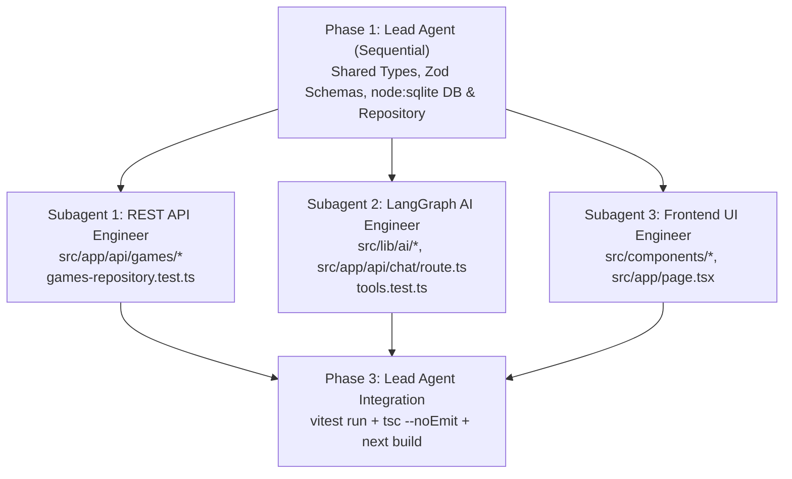

# AI Workflow & Orchestration (`AI_WORKFLOW.md`)

This document details how AI coding tools and multi-agent orchestration were used to design, build, test, and verify **IndiePulse** within the 2–3 hour assessment window.

---

## 1. Tools Used & Why

| Tool                                 | Role                                                                  | Why It Was Chosen                                                                                                                                                         |
| ------------------------------------ | --------------------------------------------------------------------- | ------------------------------------------------------------------------------------------------------------------------------------------------------------------------- |
| **Antigravity (Gemini 4)**           | Lead Architect, Phase 1 Scaffolder, Integrator & Subagent Coordinator | Provided repository-aware planning, terminal/test execution, and native `invoke_subagent` orchestration to parallelize independent backend, AI, and frontend workstreams. |
| **Parallel Subagents (`self` type)** | Specialized execution for REST API, LangGraph AI, and React UI        | Allowed 3 vertical slices to be implemented simultaneously against a shared TypeScript/Zod contract without merge conflicts.                                              |
| **Vitest + `tsc` + `next build`**    | Automated verification loop                                           | Kept AI-generated code grounded by running real typechecks, unit tests, and production Next.js builds after each phase.                                                   |

---

## 2. Concrete Prompts & Outcomes

### Prompt 1 — Architecture & Execution Planning

> _"Check `@README.md` file and let's set a plan to tackle this in the most efficient way"_

- **Outcome:** Produced a 4-phase implementation plan (`implementation_plan.md`) mapping every rubric item to concrete files, settling on `node:sqlite` for zero-dependency persistence, `@langchain/langgraph` + OpenRouter/OpenCode free models for tool calling + streaming, and a 3-subagent parallel split after Phase 1.

### Prompt 2 — Subagent 1: REST API & Repository Unit Tests

> _"You are the REST API & Unit Test Engineer for the IndiePulse indie games dashboard. Existing foundation files already exist (`src/types/game.ts`, `src/lib/db.ts`, `src/lib/games-repository.ts`). Implement `src/app/api/games/route.ts`, `src/app/api/games/[id]/route.ts` (Next.js 15 async `params`), and `src/lib/__tests__/games-repository.test.ts` using `DatabaseSync(':memory:')`. Run vitest and `npm run typecheck`."_

- **Outcome:** Delivered full CRUD + filter/sort REST handlers with Zod validation and 18 passing Vitest unit tests covering seeding, filtering, sorting, title search, catalog stats, and schema validation.

### Prompt 3 — Subagent 2: LangGraph Agent & SSE Streaming

> _"First, inspect the installed `@langchain/langgraph`, `@langchain/openai`, and `@langchain/core` packages in `node_modules` so you use exact installed v1 APIs without guessing. Implement `src/lib/ai/tools.ts` (5 Zod tools), `src/lib/ai/agent.ts` (`StateGraph` + `ToolNode` + OpenRouter/OpenCode free model config), `src/app/api/chat/route.ts` (`streamEvents` v2 SSE endpoint), and `src/lib/ai/__tests__/tools.test.ts`."_

- **Outcome:** Inspecting `node_modules` first prevented v0/v1 LangGraph API hallucinations. Produced a working `StateGraph(MessagesAnnotation)` + `ToolNode` agent with 5 catalog tools, SSE streaming (`tool_start`, `tool_end`, `token`, `done`, `error`), and 5 passing tool unit tests.

### Prompt 4 — Subagent 3: Split-Pane Dashboard & Streaming Chat UI

> _"Implement `src/components/GameModal.tsx`, `src/components/ChatPanel.tsx`, `src/components/Dashboard.tsx`, and `src/app/page.tsx` consuming `/api/games` and `/api/chat` SSE events. Include live tool-call badges, starter prompt pills, free-model selector, KPI cards, search/genre/rating filters, and sortable table."_

- **Outcome:** Delivered a responsive dark-mode split-pane UI where users can manage the catalog and watch LangGraph tool calls execute live in the chat sidebar.

### Prompt 5 — Provider Migration, Schema Fix & Markdown Chat Polish

> _"Let's try using a google-ai key... Just use the google AI models... Don't show the tool called on the chat... Let's add markdown capabilities to the chat so the text sent and responses look formatted"_

- **Outcome:** Migrated the LangGraph agent from OpenRouter/OpenCode (`ChatOpenAI`) to native `@langchain/google-genai` (`gemini-3-flash-preview` default), removed tool-call badges from `ChatPanel.tsx` for a cleaner conversational UI while keeping automatic dashboard refresh on mutations, and added `react-markdown` + `remark-gfm` formatting.

### Prompt 6 — User Management, Themes, Pagination, Bundle Optimization & Git Hygiene

> _"Let's add user management and a first user to be seeded like the games called John Doe with the email john.doe@indiegames.ai and a password importantpassword... Add the possibility to have dark and white app themes... Please add more games to the initial seed and also paginate them having around 7 by page... /next-bundle-optimizer... Use the app logo as the favicon... Please add unit tests where needed... Let's add husky and conventional commits"_

- **Outcome:** Added `users` table + `SEED_USERS`, `scrypt` password hashing, HMAC-SHA256 HTTP-only session cookies, `/api/auth/*` and `/api/users/*` routes, `LoginForm`, `UserManagementModal`, and 6 user/auth Vitest tests + 10 API route Vitest tests (39 total across 6 files); implemented Dark & Light theme switching (`ThemeProvider` + Tailwind `@custom-variant dark`), expanded `SEED_GAMES` to 28 titles with 7-per-page pagination, added `src/app/icon.svg`, lazy-loaded `Dashboard`, `MarkdownMessage`, and all modals via `next/dynamic` (reducing `/` First Load JS from `178 kB` to `107 kB`), and configured Husky (`pre-commit` + `commit-msg`) with `@commitlint/config-conventional`.

---

## 3. Where the AI Got It Wrong & How We Fixed It

### Issue 1: `better-sqlite3` Native Compilation Failure on Node.js v26

- **What went wrong:** During initial planning and `package.json` scaffolding, the AI selected `better-sqlite3` as the default SQLite driver. When `npm install` ran on the local environment (**Node.js v26.13.0**), `prebuild-install` found no prebuilt arm64 binary for Node 26 and `node-gyp` failed to compile the C++ V8 bindings (`error: no member named 'GetPrototype' in 'v8::Object'`).
- **How we fixed it:**
    1. Verified with `node -e "console.log(Object.keys(require('node:sqlite')))"` that Node 26 ships `node:sqlite` (`DatabaseSync`) natively in core with zero C++ compilation required.
    2. Tested `DatabaseSync` named parameters (`:title`, `:search`) and `lastInsertRowid` behavior in a quick Node one-liner.
    3. Replaced `better-sqlite3` with `node:sqlite` in `src/lib/db.ts` and `src/lib/games-repository.ts`, normalized `[Object: null prototype]` rows via `{ ...row }`, and removed native package dependencies from `package.json` and `next.config.ts`.
    4. Re-ran `npm install` (completed in 7s) and verified all 23 Vitest tests against `DatabaseSync(':memory:')`.

### Issue 2: Gemini 3 `thought_signature` & `exclusiveMinimum` Tool Schema Errors

- **What went wrong:** When switching to Google AI (`gemini-3-flash-preview`), routing through Google's OpenAI-compatible endpoint with `ChatOpenAI` failed on multi-turn tool calls (`Function call is missing a thought_signature`), and Zod `.positive()` generated `exclusiveMinimum: 0`, which Gemini's function-declaration schema rejected (`400 Invalid JSON payload`).
- **How we fixed it:**
    1. Switched Google AI execution in `src/lib/ai/agent.ts` to native `@langchain/google-genai` (`ChatGoogleGenerativeAI`), which preserves Gemini 3 `thought_signature`s across LangGraph tool loops.
    2. Replaced `.positive()` with `.min(1)` in `src/lib/ai/tools.ts` (`search_games.limit` and `add_or_update_game.id`) and set `dns.setDefaultResultOrder('ipv4first')` to avoid IPv6 stalls.
    3. Verified live end-to-end tool calling + streaming against `gemini-3-flash-preview` (`count_games` -> streamed Markdown response).

### Issue 3: Cached `globalThis.__gamesDb` During `next dev` & `Secure` Cookie on `http://localhost`

- **What went wrong:** When `users` table seeding was added to `src/lib/db.ts` while `next dev` was already running, `getDb()` returned the previously cached `globalForDb.__gamesDb` connection without re-running `initializeSchema()`, leaving `data/games.db` without the `users` table and blocking login. Additionally, `SESSION_COOKIE_OPTIONS` set `secure: process.env.NODE_ENV === 'production'`, which can prevent cookies on local `http://localhost:3000` production builds.
- **How we fixed it:**
    1. Added `SCHEMA_VERSION` tracking (`globalForDb.__gamesDbSchemaVersion`) in `getDb()` so schema migrations and seed backfills run automatically whenever `SCHEMA_VERSION` advances, even on a warm HMR connection.
    2. Set the cookie `secure` flag dynamically from the request protocol (`x-forwarded-proto === 'https'` or `https://` URL) in `src/app/api/auth/login/route.ts`.
    3. Verified all 39 Vitest tests across 6 test files (`games-repository.test.ts`, `users-repository.test.ts`, `tools.test.ts`, `auth-routes.test.ts`, `users-routes.test.ts`, and `games-routes.test.ts`).

---

## 4. Parallel Subagent Architecture

To maximize throughput while avoiding file conflicts, work was split into **Contract-First Foundation (Sequential)** followed by **3 Parallel Subagents**:

**Why this worked:**

- **Strict file ownership:** No two subagents touched the same file.
- **Shared contract upfront:** `src/types/game.ts` defined `Game`, `CatalogStats`, `CreateGameSchema`, `UpdateGameSchema`, and `ChatStreamEvent` before any subagent started, so `/api/chat`, `ChatPanel.tsx`, and `Dashboard.tsx` integrated with zero type mismatches on the first `next build`.
