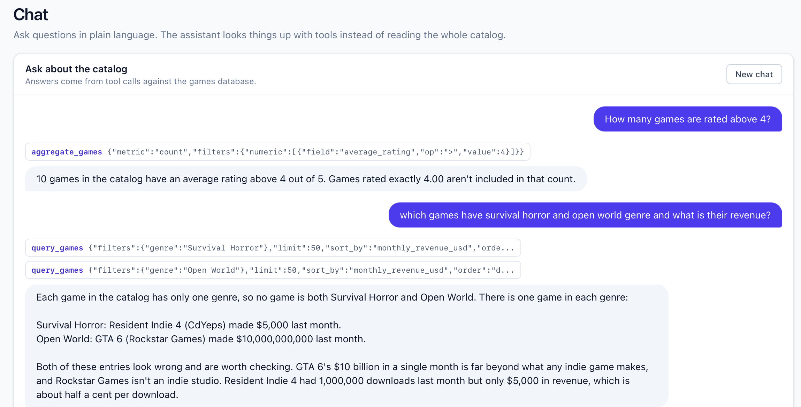
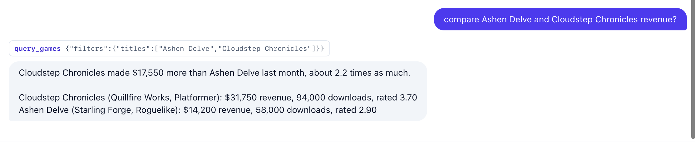
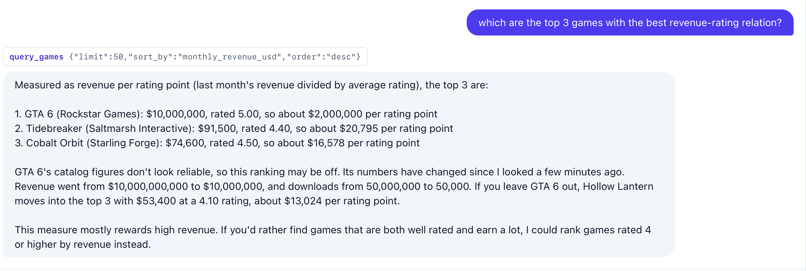

# AI workflow

This file describes how AI coding tools were used to build this submission. Everything below comes from the actual working session: one Claude Code session that orchestrated the whole build. The author's own inputs were short: two slash commands, a few plain-language messages, and answers and approvals at the plan stage. Most prompts below were written by the orchestrating agent, and each entry says who wrote it.

## 1. Tools, and what each was used for

| Tool | Used for | Why this tool for that job |
|---|---|---|
| **Claude Code** (CLI), effort set to `xhigh`, as the orchestrator | Reading the repository, planning, researching the SDK, writing the chat route and the UI, verifying, reviewing, and writing the docs | Plan mode blocks edits until a plan is approved, so the design questions (LLM layer, storage, agent split, how far to publish) were settled before any code existed |
| **`backend-scaffold-builder` subagent** (the author's own agent definition, runs on Sonnet) | Task 1: the Next.js scaffold, SQLite layer, repository, REST routes, and their tests | The data layer is deterministic work with a precise contract, so it was handed off while the orchestrator worked on the parts that needed SDK research |
| **Reviewer subagents** (general-purpose, read-only by instruction) | Blind adversarial review of the diff, in two rounds | A reviewer without the author's context has to find the bugs from the diff alone |
| **Local skills**: `harness-boostrap`, `claude-api`, `agent-review` | Writing `AGENTS.md`, looking up current Anthropic SDK and model details, running the review protocol | The `claude-api` reference carried the current model ID and parameter shapes, so the chat route was not written from memory of an older API |
| **Claude in Chrome** (browser automation) | Driving the running app: add, duplicate-title error, edit, delete, and the chat | Layout and focus bugs do not show up in type checks or API tests |

## 2. Prompts and their outcomes

**1. `/harness-boostrap` (author, run before any code existed).**
The skill audited an empty repository and wrote `AGENTS.md` plus a one-line `CLAUDE.md`. It read the local `create-next-app` and Next.js source and recorded two hazards: `create-next-app .` refuses this repository root, and by default it overwrites `AGENTS.md` and `CLAUDE.md`. That paid off later, because the scaffold was generated in a temporary directory with `--no-agents-md`.

**2. "the changes are now commited to the branch. Lets now proceed with the implementation" (author).**
The agent entered plan mode, read the brief, the author's subagent definition, and the SDK reference, then asked four questions in one batch: LLM layer, storage, how to split the work between agents, and how far to publish. The answers (Anthropic SDK tool runner, SQLite, backend subagent then frontend, commit and push but no pull request) became the plan. The plan was approved before any code was written.

**3. The delegation prompt to the subagent (written by the orchestrator).**
"Implement **Task 1** from `PLAN.md` (data layer and REST API). Read that file first; it is the full contract ... Do NOT run git commit, git push, or create a pull request ... report: files created, exact versions installed, the output status of each check, any deviation from PLAN.md with the reason."
The subagent returned in about five minutes with 47 tool calls. It reported three deviations, and each one was checked against the docs rather than trusted: it omitted `export const runtime = "nodejs"` because the Next.js 16 docs say to remove it when Cache Components is on, it added `await connection()` so synchronous SQLite reads do not run at build time, and it bumped `@types/node` so Vitest would install. The orchestrator then re-ran the type check, lint, tests, and build itself instead of relying on the report.

**4. The two review prompts (written by the orchestrator, from the `agent-review` skill).**
Reviewer A got the diff and the requirements verbatim: "Assume this diff fails to do what the requirements say. Find where." Reviewer B got only the diff: "Assume this diff is wrong. Find the bug."
They returned 15 and 14 findings. Fixed: the edit form blocked saving valid REST values such as a 4.25 rating, the chat history went out of sync after Stop or an error, seed games came back after deleting every game, blank tool filters silently matched the whole catalog, the chat endpoint accepted any content block type and any body size, the route handlers had no tests, the `.env*` ignore rule had been dropped, and several smaller accessibility and formatting issues. Rejected with reasons: authentication and rate limiting (out of scope in the brief), an environment override for the model name (a failure shows the API's message in the UI), and one question about partial text after a mid-stream fallback (rare, and cannot be exercised without the live model).
A second round re-reviewed only the delta of the fixes. It returned 11 findings. The notable ones: a real bug in my own genre-filter fix (the dropdown could show "All genres" while still filtering), a thinking-only turn that would have left an empty chat bubble and a text-less turn in the stored history, and a missing positive test for the request validation (every assertion was a rejection, so it would pass even if all input were rejected). All were fixed except one, rejected with a reason: discarding the unfinished answer when you press Stop is intentional, because the server only returns the conversation when an answer completes. The review protocol caps review at two rounds and treats a new bug in a round-one fix as a stop signal, so no third round was run. The fixes were checked by tests and in the browser instead.

**5. A mock alternative, then a live run with real credits (author, two prompts).**

First prompt, summarized: "let's add a mock alternative so we can test without adding credits". The agent had laid out three options (an offline mock with an automated test, a mock plus a free real-model provider, or instructions only) and said what a mock can and cannot prove. The author picked the offline mock and asked to review the changes before anything was committed.

The outcome: the local stand-in for the Messages API that the agent had written for its own testing (no key was available in its environment) moved into the repository as `scripts/mock-anthropic.mjs`. `npm run dev:mock` runs the app against it and overrides a real key in `.env`, because variables set on the command win over `.env` files. `tests/chat-route.test.ts` runs the real chat route against it as part of `npm test` (8 tests). The chat also shows a clear message, pointing at the mock, when the API reports an empty balance. The stand-in is what found the bug described next, on the first end-to-end run.

Second prompt, with the three screenshots attached: "the api key now has 5 usd in credits, i already ask a few questions to test it and everything seems fine. These are the images so we can add it to the 2nd requirement from the ai workflow doc ... The mock can stay as an alternative."

The outcome: a live run with the real model. The author added $5 of API credits, asked the chat a few questions against `claude-opus-5-5`, and found everything fine. The mock stays in the repository as an alternative for anyone without credits. Three screenshots from the live run follow. The chips above each answer are the tool calls the model made.

Screenshot 1. The count question used one `aggregate_games` call, and the answer notes that games rated exactly 4.00 are not included. The two-genre question used one `query_games` call per genre, and the model pointed out that a game has a single genre, so no game is both. It also flagged two catalog entries whose figures looked implausible, one with $10,000,000,000 of monthly revenue.

Screenshot 2. A comparison used one `query_games` call with a `titles` filter. The difference ($17,550) and the ratio (about 2.2 times) in the answer match the two revenues listed under them ($31,750 and $14,200).

Screenshot 3. An open-ended question ("top 3 games with the best revenue-rating relation") used one `query_games` call sorted by revenue. The model chose its own measure (revenue per rating point) and worked it out for each game. It also said that one game's figures differed from what it had seen earlier in the conversation, which fits the design: each question reads the current database through the tools.

**6. "the dashboard doesnt have pagination, currently its a infinite scrolling, Lets implement a proper pagination feature" (author).**
The agent read the dashboard component, the repository, the REST route, the brief, and the branch notes, then asked two questions in one batch: whether paging should happen in the browser or in SQL, and whether to publish when done. It said that SQL paging scales further but is about four to five times the diff and changes the `GET /api/games` contract. The author chose paging in the browser and keeping the work local. The agent wrote the plan and it was approved before any code was written.

The outcome: `lib/pagination.ts` with 12 unit tests, and a footer under the table with "Showing 1-10 of 70 games", a rows-per-page select (10, 25, 50), and Previous, numbered, and Next buttons. `paginate` clamps the page into range, so deleting the last row of the last page falls back to the previous page without an effect. Search, genre, sort, and page-size changes return to page 1 inside their event handlers. `typecheck`, `lint`, `npm test` (44 tests), and `build` pass.

The agent checked it in a browser on a production build, using a throwaway database on another port, because the author's dev server on port 3000 uses their real database and the check deletes and edits rows. It checked the page buttons, all three page sizes, each reset rule, an empty result, deleting the only row on the last page (the view moved from page 8 to page 7), and editing a game on page 3 (the table stayed on page 3). That run found one defect, "Showing 1-1 of 1 games", which was fixed to read "game".

Four mistakes in the agent's own checking were caught and redone. An exit code was read with bash's `PIPESTATUS` in zsh and printed nothing, so the checks were re-run without pipes. A build was run with its output sent to `/tmp` and its exit code hidden by `|| true`, so its result was unknown until it was re-run properly. The first start of the test server never happened, because zsh aborted the command on an unmatched `rm` glob, and the agent found that in the task output. A browser tool blocked a result formatted as `key=value` pairs, so the same script was re-run and returned JSON.

Before committing, the agent ran the review protocol (`agent-review`) on the whole uncommitted diff with two blind reviewers: one given the diff and the request, one given only the diff. The working tree was fingerprinted before and after each round and did not change. Both reviewers found, independently, that the page number in state was never reconciled with the clamped page (deleting the last row of page 8 showed page 7 but kept 8 in state, so a later add jumped back to page 8), that disabling Previous and Next dropped keyboard focus, that a saved game could land on another page with no cue, and that the 25 and 50 row tables left the view at the bottom after paging. They also found a test that would still pass with the `count <= 7` guard in `pageNumbers` deleted (a mutation check now confirms the new assertions fail without it) and a test that could not fail, which was deleted. Rejected, with reasons: a tie in the seed's download counts (the brief ranks by revenue, which has no ties), component tests for the reset wiring (there is no component test setup and the browser checks cover it), and a claim that the entries in this file cannot be verified (they happened in this session).

Round two reviewed only the fixes, with one reviewer, and found a bug in the agent's own round-one fix. The dialog parsed the response body after a successful save, so a malformed 2xx response would show "could not reach the server" after the game was already saved, and a retry would then fail with a duplicate title. The agent removed that failure path. It also fixed four smaller findings (keyboard scrolling, a click on the current page, a stale notice, a wrong test comment). It did not run a third round, as the protocol says, and checked the fixes by tests and in a browser instead.

The browser step did not go smoothly. After the fixes, every button on the page looked dead. The agent checked the cause before touching code: the Chrome window it drives was in the background (`document.hidden` was true), so React never hydrated the lazily streamed dashboard. A fresh tab and a window resize did not help, and the author then tried making the window visible, which did not help either. The agent stopped using that tool and ran the same checks against a throwaway server through a headless Chrome script with real mouse and key events. All 19 checks passed (11 on the first run and 8 more after the agent fixed a navigation mistake in its own script).

## 3. One moment the AI got it wrong

The first end-to-end chat run printed this answer:

> Let me check the catalog.Tidebreaker made the most revenue last month: $91,500.

The assistant's text before a tool call and its final answer are separate content blocks. The route streamed every `text_delta` into one string, so the two blocks were glued together with no space. Type checking, lint, and the unit tests all passed, because each piece was correct on its own. Only an end-to-end run with realistic output showed it.

The fix is in `app/api/chat/route.ts`: when a new text block starts after text was already sent, the route first emits a blank line. The smoke script now asserts the separation.

Three smaller mistakes were also caught by running the real thing rather than reading the code:

- The table's screen-reader-only "Actions" header cell widened the whole page on a narrow screen. In the browser the page scrolled sideways by 200px. The fix was `relative` on the scroll wrapper.
- The chat card height used a fixed `calc(100vh - 9rem)` that pushed the input below the fold once the subtitle wrapped. It is now a flex layout.
- The agent first read a click that did nothing as a hydration bug in the app. The real cause was the test setup: the dev server blocks `127.0.0.1` by default and allows `localhost`. No code change was needed, and the README now says to use `localhost`.

## 4. Parallel agents, subagents, and worktrees

- **One background subagent.** The Task 1 subagent ran in the background while the orchestrator probed the SDK's tool runner offline with a mocked `fetch` (to learn what `runner.params.messages` holds after the loop and what the default `thread` mode sends) and drafted the chat client in a scratch directory outside the repository. The drafts stayed outside the repository so that the subagent's own type check, lint, and build would not see half-written files.
- **Three read-only reviewer subagents**, two in parallel in round one and one in round two. The working tree was hashed before and after each round and was unchanged, so the read-only constraint held.
- **What did not parallelize:** the chat route and the UI depend on the repository's types, so they waited for Task 1.
- **No git worktrees.** All work happened in place on `submission/cristian-yepes`.

## 5. What was verified live, and what was not

The author ran the chat against the real model (`claude-opus-5-5`) with $5 of API credits, and the screenshots in section 2 are from that run. The live API accepted the request settings, including the two beta parameters (`server-side-fallback-2026-07-01` and `thinking-binding-controls-2026-08-01`), because the chat answered.

Not covered: automated tests against the real model (they would cost credits and vary from run to run), answer quality beyond the few questions shown, and the mid-stream fallback path, which a catalog question is unlikely to trigger. The route, tools, streaming, and conversation replay are also tested against the offline mock in `scripts/`, which is part of the repository and of `npm test`.
