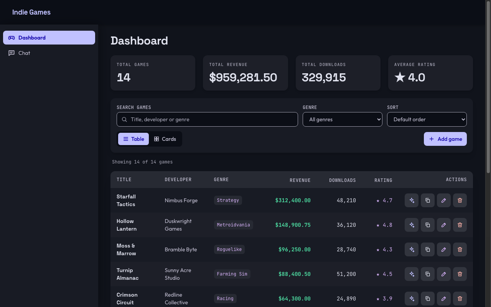
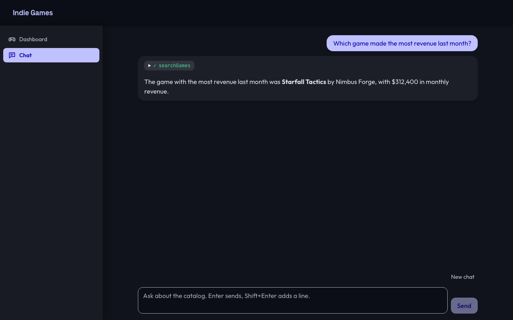

# Indie Games Dashboard + AI Chat

An internal dashboard to manage a catalog of indie games, plus a chat that answers questions about the catalog by calling tools and streaming the response.

| Dashboard | Chat |
|---|---|
|  |  |

## Quick start

Requires Node 22+ and an [Anthropic API key](https://console.anthropic.com/).

```bash
npm install
cp .env.example .env.local   # then set ANTHROPIC_API_KEY in .env.local
npm run dev                  # http://localhost:3000
```

The SQLite database is created in `data/games.db` and seeded with 14 games on first use. The dashboard works without a key; only the chat needs one.

## Features

| Requirement | Where |
|---|---|
| Games CRUD with all 6 fields, persisted in SQLite | `/`, `lib/games.ts` |
| REST API | `/api/games`, `/api/games/:id` |
| Chat for natural-language questions | `/chat`, `/api/chat` |
| Tool calling, with no catalog data in the prompt | `lib/ai/tools.ts`, `lib/ai/prompt.ts` |
| Streaming responses | Text and tool progress arrive as they are produced |
| Dashboard and chat views, Tailwind | KPI cards, table and card views, sorting, search by title, developer, or genre, and a genre filter |

Each game can be copied as JSON, and its Ask AI link opens the chat with a question ready to review. The link never sends it, so opening one spends no LLM credit. The UI is dark only.

The chat also has Stop, Retry, New chat, suggested questions, and a chip showing each tool call. The chat keeps its conversation when you navigate to the dashboard and back, but not across a page reload.

## Architecture

```text
Dashboard (Server Component) ──────────────┐
Table and forms ── /api/games ─────────────┤
                                           ├─► lib/games.ts ─► SQLite
Chat UI ── /api/chat ── tools (lib/ai) ────┘
                 │
                 └─ streamText ◄─► LLM provider (strategy + factory)
```

- **All SQL lives in `lib/games.ts`.** Route handlers and tools call it and never touch the database.
- **Zod is the single source of truth** for request bodies, query params, and tool inputs (`lib/schema.ts`).
- **Providers are strategies** in `lib/ai/providers/`. Adding one takes a strategy file and one line in `factory.ts`, and provider SDKs are only imported there.

## Configuration

| Variable | Default | Purpose |
|---|---|---|
| `AI_PROVIDER` | `anthropic` | `anthropic` or `openai` |
| `ANTHROPIC_API_KEY` / `OPENAI_API_KEY` | none | Key of the active provider |
| `AI_MODEL` | `claude-haiku-5-5` / `gpt-6-astra` | Overrides the provider's default model |
| `DATABASE_PATH` | `data/games.db` | Database location |

## API reference

| Method | Path | Purpose | Success |
|---|---|---|---|
| `GET` | `/api/games` | List games. Query: `genre`, `developer`, `minRating`, `maxRating`, `minRevenue`, `search`, `sortBy`, `order`, `limit` | `200` |
| `POST` | `/api/games` | Create a game. `monthly_revenue_usd` must be from 0 to 1 trillion | `201` |
| `GET` | `/api/games/:id` | Get one game | `200` |
| `PUT` | `/api/games/:id` | Update the fields sent (partial) | `200` |
| `DELETE` | `/api/games/:id` | Delete a game | `204` |
| `POST` | `/api/chat` | Stream a chat response | `200` |

Errors share one envelope:

```json
{ "error": { "code": "VALIDATION_ERROR", "message": "Request validation failed", "issues": { "average_rating": ["Must be between 0 and 5"] } } }
```

```bash
curl "http://localhost:3000/api/games?minRating=4&sortBy=monthly_revenue_usd&order=desc&limit=3"

curl -X POST http://localhost:3000/api/games \
  -H "Content-Type: application/json" \
  -d '{"title":"QA Test Game","developer":"QA","genre":"Puzzle","monthly_revenue_usd":1000,"monthly_downloads":50,"average_rating":4.2}'

curl -X PUT http://localhost:3000/api/games/1 \
  -H "Content-Type: application/json" \
  -d '{"average_rating":4.9}'
```

## AI chat

| Tool | Input | Purpose |
|---|---|---|
| `searchGames` | Filters, `sortBy`, `order`, `limit` (max 25) | Find and rank games. `developer` and `search` match partially |
| `getCatalogStats` | Filters | Exact counts, totals, and averages, so the model doesn't calculate them |
| `compareGames` | 2 to 5 `titles` | Fetch specific games, and report the titles not found |
| `listGenres` | None | Find the exact genre name to filter by |

The prompt contains rules and no catalog data, so every answer comes from a tool and reflects the current data: edit a game and the next answer uses the new value. Try:

- *Which game made the most revenue last month?*
- *How many games are rated above 4?*
- *Compare revenue of Starfall Tactics vs Moss and Marrow.*

## Testing

```bash
npm run typecheck && npm run lint && npm test
```

The 388 tests run with no network or API key. The backend project covers the repository against real SQLite, the API, the provider factory, the tools, and the chat route with a mock model. The frontend project covers the dashboard and chat with the real `useChat` hook, using React Testing Library and MSW.

Automated tests don't show what a real model does, so the chat was also checked live against Anthropic. See [`tasks/09-qa-findings.md`](tasks/09-qa-findings.md).

## Trade-offs and assumptions

- **"Last month" means the current monthly values.** The catalog stores no history, so `monthly_revenue_usd` is the only monthly figure.
- **"Above 4" is strict.** `minRating` excludes a rating of exactly 4.0.
- **The default model is Haiku with thinking disabled**, for faster and smoother streaming. `claude-sonnet-5-5` can't turn thinking off, so the provider uses its lowest level. In one test of the same 10-row answer, Sonnet took 9.3 s and arrived in 19 network reads; Haiku took 5.1 s and arrived in 154. Use `AI_MODEL` to change it.
- **OpenAI has not been validated live**, because that account had no credit. Its strategy is covered by unit tests only. Anthropic is the default because it is the provider that was tested.
- **Filtering and sorting on the dashboard run in the browser**, on up to 100 loaded rows. The table says so when the catalog is larger. There is no pagination.
- **Money is stored as a float**, which is enough for display and these totals but not for accounting.
- **An empty database is seeded when the server opens it.** If you delete every game, the seed data returns at the next restart.
- **No authentication and no rate limit on the chat**, as auth and deployment are out of scope. Don't expose this publicly: anyone could spend your API credit.

### Known limitations

- If Stop leaves a partial answer in the conversation, the model may continue that request in its next answer. A request stopped before any text is marked as unanswered, so it isn't resumed unless you ask.
- The model sometimes announces a search retry in one short sentence, even though the prompt tells it not to.
- A short follow-up such as "And which one…?" after messages in another language can be answered in the earlier language.
- `npm audit` reports moderate advisories in the ESLint dependency chain, which is development-only.

## Troubleshooting

**"Hydration failed" with `__next_metadata_boundary__` and `display:contents` in the diff:** Something in the browser, most likely an extension, is adding an element to `<body>` before React hydrates. The app's HTML is correct, and this happens in `next dev` and, as React error #418, in `next start`. To confirm, open the page in a Chrome profile with no extensions. To find the extension, turn yours off one at a time and reload. You can then exclude `localhost` from its site access, though that step wasn't tested here.

## With more time

- Add monthly revenue history, so "last month" is a real query.
- Persist conversations.
- Add server-side pagination, search, and sorting.
- Add an evaluation suite that runs the golden questions against each provider.
- Validate OpenAI live, including Stop during reasoning.

## Project structure

```text
app/              Pages, route handlers
components/       games/, chat/, ui/
lib/              games.ts (repository), db.ts, schema.ts
lib/ai/           tools, prompt, providers/ (strategy + factory)
tasks/            Work plan and QA findings
.claude/          Agents and skills used to build this
AI_WORKFLOW.md    How AI tools were used
AI_LOG.md         Raw log of prompts and fixes
```
