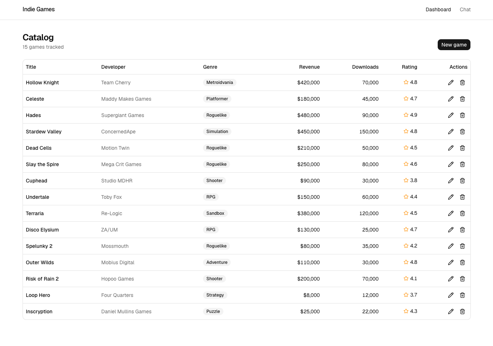
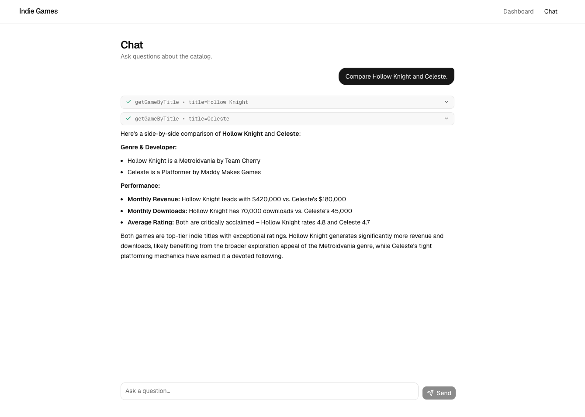

# Indie Games Dashboard with AI Chat

An internal dashboard for managing a small catalog of indie games, paired with an AI chat that answers natural-language questions about the catalog by invoking typed tools and streaming the response back to the client. The application is built on Next.js 16 (App Router) with TypeScript, Tailwind CSS, the Vercel AI SDK v6, and Zod for end-to-end validation. This is a technical assessment submission; the original brief is preserved at [/README.original.md](README.original.md).

## Demo



The dashboard provides full CRUD over the games catalog: create, edit, and delete via a reused modal form; the table presents 15 seeded indie games with formatted revenue, downloads, and ratings.



The chat answers questions by invoking typed tools against the catalog. Tool calls render as expandable badges so the tool-calling behaviour is visible without reading code. Responses stream in real time.

## Stack

| Layer | Choice | Why |
|---|---|---|
| Framework | Next.js 16.2.6 (App Router) | Imposed by the assessment; current Active LTS |
| Language | TypeScript (strict) | Imposed by the assessment |
| Styling | Tailwind CSS v4 | Imposed by the assessment |
| UI primitives | shadcn/ui (new-york style, zinc palette) | Copy-into-repo model; full code ownership; accessibility by default |
| Persistence | JSON file at /data/games.json with atomic writes | Zero setup for the reviewer; domain too small to justify SQLite |
| LLM SDK | Vercel AI SDK v6 | Resolves streaming and tool calling end-to-end with strict types |
| Default LLM | Anthropic Claude Sonnet 4.5 | Strong tool-calling behaviour |
| Alternative LLM | OpenAI gpt-4o-mini (configurable via env var) | Reviewer flexibility |
| Schema validation | Zod | Reused at the schema layer, the API boundary, the repository, and the chat tools |
| Markdown | react-markdown + remark-gfm (constrained allowlist) | Renders assistant text without permitting arbitrary HTML or links |

## Getting Started

### Prerequisites

- Node.js 20 or later
- npm
- An API key from Anthropic (default) or OpenAI

### Installation

```bash
git clone <fork-url>
cd tech-test-fullstack-engineer-ai
npm install
cp .env.example .env.local
# edit .env.local with your API key (see Environment variables below)
npm run dev
```

The app is then available at http://localhost:3000.

### Environment variables

| Variable | Required | Default | Notes |
|---|---|---|---|
| LLM_PROVIDER | no | anthropic | "anthropic" or "openai" |
| ANTHROPIC_API_KEY | required when LLM_PROVIDER=anthropic | — | Obtain at console.anthropic.com |
| OPENAI_API_KEY | required when LLM_PROVIDER=openai | — | Obtain at platform.openai.com |

If the relevant key is missing, the chat endpoint returns HTTP 503 with `{ error: "PROVIDER_NOT_CONFIGURED" }` and the chat UI shows a clear error banner. Upstream provider failures return HTTP 502 with `{ error: "PROVIDER_UPSTREAM" }`. The dashboard remains fully usable in either failure mode because the REST API does not require the LLM.

### Useful npm scripts

| Script | Purpose |
|---|---|
| dev | Next.js dev server with Turbopack |
| build | Production build |
| start | Production server (after build) |
| lint | ESLint |
| validate:data | Validates /data/games.json against the Zod schema and seed distribution constraints |
| smoke:repo | Exercises the repository layer end-to-end: create, read, update, delete with persistence checks |
| test:chat | (Requires the dev server running and ANTHROPIC_API_KEY set) Sends two sample questions to /api/chat and prints the streamed output |

## Architecture

The codebase is organised in four layers, in order of dependency:

**Data layer** — `/data/games.json` holds the seeded catalog (15 indie games spanning 10 genres). `/lib/games/schema.ts` defines the Zod schemas and the inferred TypeScript types. `/lib/games/seed-validate.ts` is a CLI script that validates the seed against both the schema and the distribution constraints.

**Repository layer** — `/lib/games/repository.ts` exposes five async functions (`listGames`, `getGameById`, `createGame`, `updateGame`, `deleteGame`) that wrap the JSON file. Writes use the temp-file + rename pattern for atomic-write semantics. The repository is the single source of truth consumed by both the REST API and the chat tools.

**Transport layer** — `/app/api/games` exposes the REST endpoints (GET, POST, PATCH, DELETE) that delegate to the repository. `/app/api/chat/route.ts` exposes the streaming chat endpoint, configured with provider selection, four read-only tools, and a verbatim system prompt. Route handlers handle only HTTP concerns; business logic lives in `/lib`.

**UI layer** — `/app/page.tsx` renders the dashboard, which fetches from the REST API and presents a table with CRUD actions. `/app/chat/page.tsx` renders the chat, which uses `useChat` from `@ai-sdk/react` to stream messages and visualise each tool invocation as an expandable badge. Both pages share a layout shell in `/app/layout.tsx`.

## Chat tool inventory

The chat exposes four read-only tools over the catalog. They are read-only by design (see Trade-offs). Each tool is defined with a Zod inputSchema, wraps its execute body in try/catch, and returns structured errors instead of throwing.

| Tool | Purpose |
|---|---|
| listGames | Compact projection of the catalog with optional genre and minRating filters. Used for counting and scoped enumeration. |
| queryGames | Ranking, filtering, and top-N queries. Sorts by any numeric metric in either direction. The workhorse tool. |
| getGameByTitle | Resolves a user-provided title to a game record via three-tier matching (exact case-insensitive, substring, Levenshtein fallback). Returns suggestions when no match is confident. |
| aggregateGames | Sum, average, min, max, or count over a numeric field, optionally filtered. |

## Trade-offs

Honest decisions made under the 2–3 hour budget. Full rationale for each is in [/docs/decisions-log.md](docs/decisions-log.md).

- **JSON persistence over SQLite.** Zero installation friction for the reviewer (no native build step that can fail across platforms) and the 6-field flat domain does not justify a relational store. For production I would use Postgres or SQLite; the atomic-write helper inside the repository limits the failure mode to last-writer-wins rather than partial-file corruption.

- **Chat tools are read-only.** The CRUD requirement is satisfied by the dashboard UI and the REST API. Exposing write operations to the chat would have required undo semantics, authentication, or accepting destructive operations triggered by ambiguous natural language — none of which is in scope for the assessment.

- **shadcn/ui over hand-rolled Tailwind components.** Higher time-to-quality, accessibility and focus states resolved by default, and the components are real code in /components/ui rather than opaque dependency imports. The reviewer can inspect every primitive in the repo.

- **Vercel AI SDK over a direct Anthropic or OpenAI client.** Provider portability via one env-var change, and the SDK resolves both the LLM-to-server stream and the server-to-client stream (the latter is non-trivial to implement correctly by hand). The cost is one more abstraction layer.

- **Phased development with verification gates over single-shot generation.** Each of the ten implementation phases produced a focused commit and was verified mechanically (smoke tests, lint, build) before continuing. The trade-off was tighter prompt budgets per phase versus a faster but harder-to-audit single-shot.

- **No automated test suite.** The assessment marks test coverage as out of scope. I substituted CLI smoke tests (`validate:data`, `smoke:repo`, `test:chat`) and one round of manual curl coverage for the REST API. Production would warrant Vitest or Playwright; the smoke tests are sufficient to verify happy paths.

- **Hardcoded model IDs (`claude-sonnet-4-5`, `gpt-4o-mini`) over dynamic discovery.** A model rotation would require restarting the dev server anyway; the IDs carry an inline comment noting they are current as of May 2026 and to update if the SDK rejects them.

## Time spent

Approximately [TO FILL: I will provide this manually before submission].

## See also

- [/docs/plan.md](docs/plan.md) — the phase-by-phase plan, locked before implementation began
- [/docs/decisions-log.md](docs/decisions-log.md) — each technical decision with alternatives considered, rationale, and consequence
- [/docs/prompts-log.md](docs/prompts-log.md) — chronological record of meaningful prompts (source material for AI_WORKFLOW.md)
- [/AI_WORKFLOW.md](AI_WORKFLOW.md) — how I used AI coding tools during this assessment (Phase 9 deliverable)
- [/README.original.md](README.original.md) — the assessment brief, preserved for reference
